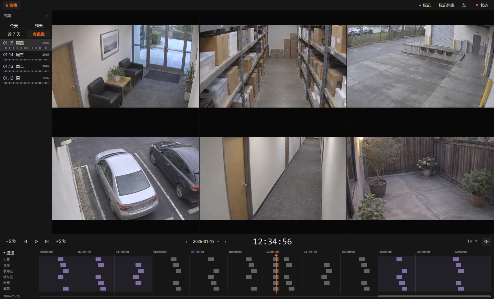

# ReSee

**ReSee** 是一款跨平台（Windows / macOS）多路历史监控录像极速同步回放桌面软件，专为 NAS / 本地存储的小米摄像头（单摄与双摄）MP4 录像设计，在统一绝对时间轴上实现多路画面的严格同步与毫秒级响应定位。



*演示截图中的六路画面均为合成场景。*

## Windows 下载

前往 [GitHub Releases](https://github.com/a15112542067-YBZJ/ReSee/releases/latest) 下载 Windows x64 ZIP。解压整个 ZIP，双击 `ReSee.exe`。Qt、FFmpeg 和 MSVC 运行库随包提供。

第一次启动时，选择一个包含摄像机 MP4 录像的本地文件夹或 NAS 目录。可以稍后在「设置 → 机位」添加摄像机、修改目录或重新扫描。若扫描遇到问题，点击顶部「录像目录提示」查看原因和处理方式。NAS 目录无法访问时，先在系统文件管理器中确认共享目录已连接并可读取。

## 核心特性

- **动态多路严格同步**：支持任意数量摄像头自由增删（单摄 `00_`、双摄 `00_ + 10_`），自适应多路宫格与单路放大布局；全路共享 `MasterClock` 统一真实时间轴。
- **NAS / 本地只读扫描与 SQLite 增量索引**：支持递归扫描目录与独立切片边界定位，绝不修改原始录像文件；后台校验文件元数据并支持按时间戳极速 Seek。
- **GPU 硬件加速与本地缓存**：基于 FFmpeg (`D3D11VA` / `VideoToolbox`) 硬件解码与本地 SSD 块缓存，支持 `0.5x ~ 8x` 倍速播放与滚轮微调。
- **时间轴昼夜配色与离线天文计算**：支持按摄像头所在经纬度/时区离线计算每日真实日出日落时间，并用自定义颜色区分白天与夜晚录像时段；未配置地区时自动以 `06:00–18:00` 划分。
- **日期导航与录像健康监测**：左侧 24 小时覆盖微缩条跨日同刻对比；顶部「状态」弹层实时统计 NAS 存储占比、写入状态与首帧缩略图联动。
- **音频监听与事件书签**：支持聚焦跟随或手动切换音频监听（Opus 48kHz / AAC 等）、实时 PCM 电平表与带截图的事件标记。

## 适用录像文件命名规则

ReSee 通过文件名中的绝对时间区间与 MP4 内部时长建立索引：

```text
通道编号_YYYYMMDDHHMMSS_YYYYMMDDHHMMSS.mp4
```

示例：
- 单摄：`00_20260101100000_20260101101500.mp4`
- 双摄：`00_20260101100000_20260101101500.mp4` 与 `10_20260101100000_20260101101500.mp4`

## 首次使用

1. 点击「添加摄像机」并选择录像目录。含有 `10_*.mp4` 的目录会被识别为双摄，也可以手动切换。
2. 在「设置 → 机位」修改通道名称、偏移或录像路径，也可移除摄像机。改动录像路径后，点击「应用目录并重新扫描」。
3. 双击画面聚焦，按 Esc 还原。走带栏时间码支持直接输入（如 `15:30`、`-10m`），时间轴支持滚轮缩放和 Ctrl + 滚轮平移。

应用默认使用系统的应用数据目录保存 `config.json`、索引、缓存与书签。设置环境变量 `RESEE_DATA_DIR` 为本机绝对路径，可以用同一程序打开独立的配置和数据目录。交付源码无需附带运行时数据。

## 技术栈与依赖

- **C++20** + **CMake 3.24+** + **Ninja**
- **Qt 6.8+** (`Quick`, `QuickControls2`, `QuickDialogs2`, `Multimedia`, `Concurrent`, `ShaderTools`)
- **FFmpeg** (`avcodec`, `avformat`, `avutil`, `swscale`, `swresample`, `avfilter`)
- **SQLite3**（内置于 `third_party/sqlite`）

## 目录结构

```text
ReSee-OpenSource/
├── CMakeLists.txt
├── LICENSE
├── README.md
├── resources/          # 应用图标与资源
├── shaders/            # NV12 GPU 渲染着色器
├── third_party/        # SQLite3 等第三方源码
├── qml/                # Qt Quick / QML 界面组件
└── src/
    ├── app/            # 控制器、时间轴/日期/书签/健康模型
    ├── cache/          # NAS 并发预读与 SSD 块缓存
    ├── core/           # 配置、日志、时间工具、离线日出日落计算
    ├── decode/         # FFmpeg 硬件解码与时间校正
    ├── health/         # 录像存活与存储占比监测
    ├── index/          # 目录扫描、MP4 sidx 解析与 SQLite 索引
    ├── render/         # RHI / QQuickItem 视频渲染
    └── sync/           # 全局主时钟、音频同步与多路调度
```

## 快速构建（Windows 示例）

1. 准备 **Qt 6.8+** 与 **FFmpeg** 开发库（或将其放置/软链到项目根目录的 `_qt6` 与 `_ffmpeg`）。
2. 使用 VS2022 x64 开发命令行配置并编译：

```bat
cmake -B build -G Ninja -DCMAKE_BUILD_TYPE=Release -DMC_WIN32_GUI=ON
cmake --build build --target ReSee -j 8
```

3. 维护者可以在 VS2022 x64 开发命令行使用 [Windows 打包脚本](scripts/package-windows.ps1)。向脚本传入本次编译所用的 Qt 与 LGPL 共享版 FFmpeg SDK，以及 MSVC x64 应用本地运行库路径。公开包使用动态链接的 Qt 和 FFmpeg 库，第三方许可和对应源码见发行页。

## 快速构建（macOS）

已验证环境：Apple Silicon arm64，macOS 27.2，Xcode Command Line Tools 27.2，CMake 4.5.1，Ninja 1.13.2，Qt 6.12.0（Homebrew），FFmpeg 8.1.3（Homebrew `ffmpeg@8`）。工程要求 CMake 3.24+、Qt 6.8+、C++20；Qt 需包含 `Quick`、`QuickControls2`、`QuickDialogs2`、`Multimedia`、`ShaderTools`、`Concurrent` 以及 `Qt6::GuiPrivate`（私有头文件，用于 NV12 场景图渲染）。

使用原生 Homebrew 构建：

```bash
brew install cmake ninja qt ffmpeg@8
QT_PREFIX="$(brew --prefix qt)"
FFMPEG_PREFIX="$(brew --prefix ffmpeg@8)"
cmake -S . -B build/macos -G Ninja \
  -DCMAKE_BUILD_TYPE=Release \
  -DCMAKE_PREFIX_PATH="$QT_PREFIX" \
  -DFFMPEG_ROOT="$FFMPEG_PREFIX"
cmake --build build/macos --target ReSee --parallel
```

构建产物为 `build/macos/bin/ReSee.app`。若 `brew` 的 Qt 版本不满足，可用 `CMAKE_PREFIX_PATH` 指向其它 Qt 6.8+ SDK；不要把本机 SDK 路径写进源码。

打包为可独立双击启动的 `.app`（收集 Qt 运行时、QML 插件以及 FFmpeg 传递依赖，改写为 `@rpath`，最后 ad-hoc 签名）：

```bash
"$QT_PREFIX/bin/macdeployqt" build/macos/bin/ReSee.app -qmldir="$PWD/qml"
./scripts/bundle-finalize.sh build/macos/bin/ReSee.app
```

完成后可用 `otool -L build/macos/bin/ReSee.app/Contents/MacOS/ReSee` 确认不再有指向本机 Homebrew 前缀的依赖。Developer ID 签名与公证属于独立发布步骤，不在本脚本范围内。

运行时数据默认位于系统应用数据目录；设置 `RESEE_DATA_DIR` 为本机绝对路径可隔离配置、索引、缓存与截图。

## License

[MIT](LICENSE)
